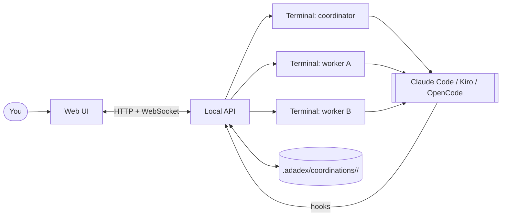
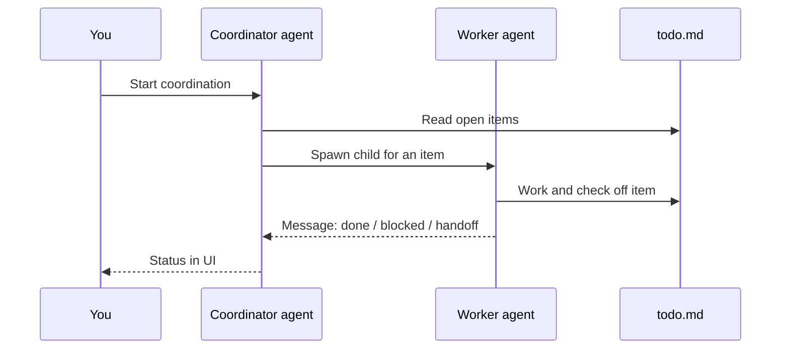
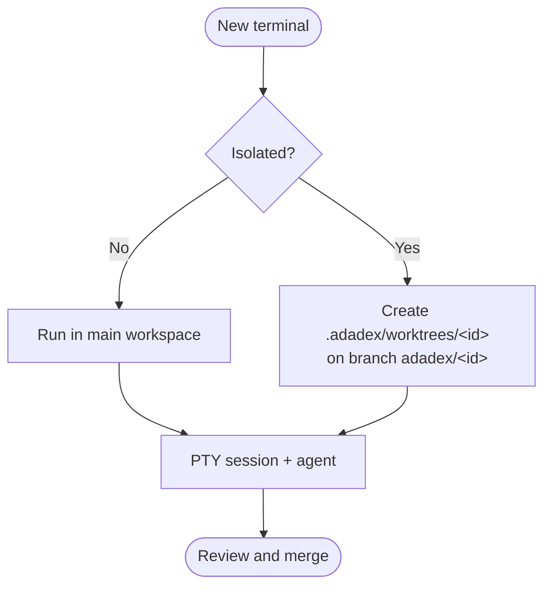
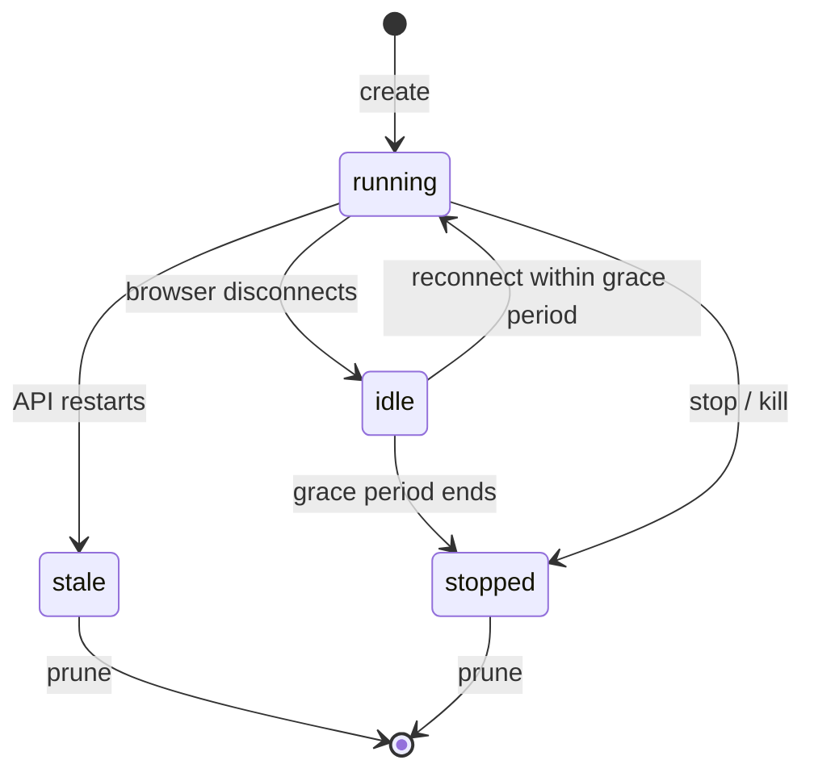
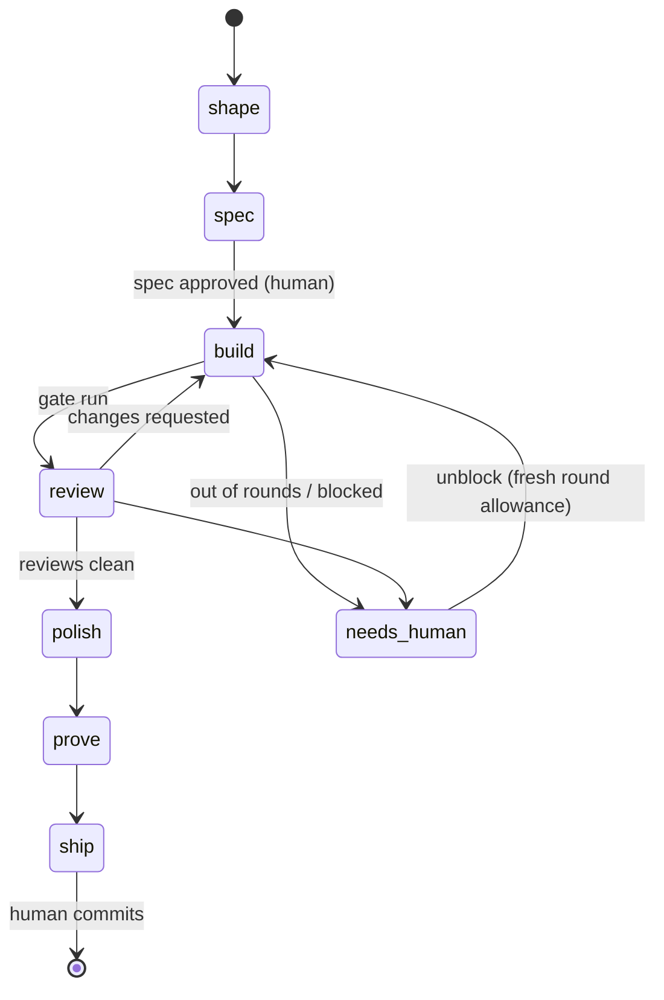
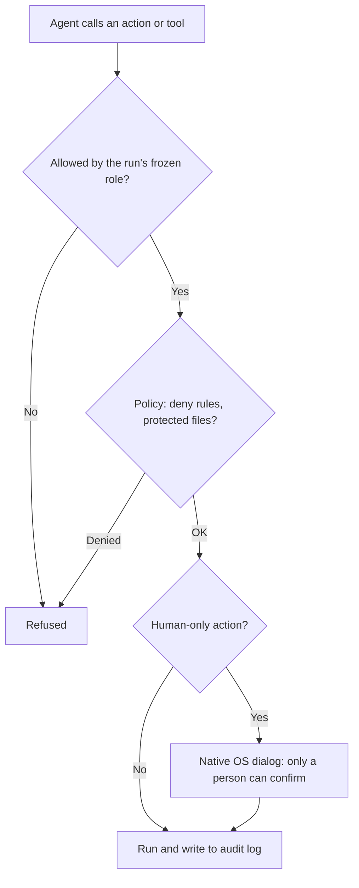
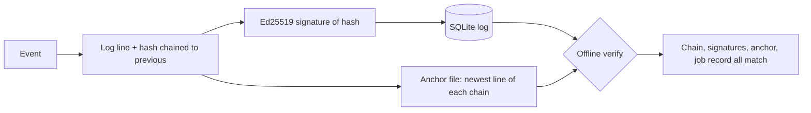

<div align="center">


**Turn chaos into execution.**

[](https://www.typescriptlang.org/)
[](https://nodejs.org/)

<details>
<summary><strong>Docs</strong></summary>
<br>

[Docs Home](docs/index.md) &nbsp;|&nbsp;
[Installation](docs/getting-started/installation.md) &nbsp;|&nbsp;
[Quickstart](docs/getting-started/quickstart.md) &nbsp;|&nbsp;
[Mental Model](docs/concepts/mental-model.md) &nbsp;|&nbsp;
[Coordination](docs/concepts/coordination.md) &nbsp;|&nbsp;
[Runtime and API](docs/concepts/runtime-and-api.md) &nbsp;|&nbsp;
[Working With Todos](docs/guides/working-with-todos.md) &nbsp;|&nbsp;
[Orchestrating Child Agents](docs/guides/orchestrating-child-agents.md) &nbsp;|&nbsp;
[Inter-Agent Messaging](docs/guides/inter-agent-messaging.md) &nbsp;|&nbsp;
[CLI Reference](docs/reference/cli.md) &nbsp;|&nbsp;
[Filesystem Layout](docs/reference/filesystem-layout.md) &nbsp;|&nbsp;
[API Reference](docs/reference/api.md) &nbsp;|&nbsp;
[Experimental Features](docs/reference/experimental-features.md) &nbsp;|&nbsp;
[Troubleshooting](docs/reference/troubleshooting.md)

</details>

</div>

Adadex is a web-first orchestration layer for running multiple coding agents in parallel. Instead of juggling many terminal sessions and losing track of what each one is doing, Adadex gives each job its own scoped context, task list, and notes. One agent session can spawn others, assign them work, and exchange messages with them while you stay at the orchestration layer.

> **Claude Code by default.** Adadex launches terminals with [Claude Code](https://docs.claude.com/en/docs/claude-code) (`claude`) as the coding agent. Kiro CLI (`kiro-cli`) and OpenCode (`opencode`) can also be launched as terminal providers. The agent provider is chosen per terminal, not per coordination.

## What Adadex Does

- Creates **coordinations** as scoped job containers: each one gets its own `CONTEXT.md`, `todo.md`, and notes
- Runs multiple coding agent terminals side by side so one developer can manage several sessions at once
- Runs terminals against **Claude Code** (`claude`) by default, with Kiro CLI and OpenCode as alternatives
- Lets one agent session spawn others, assign them work, and exchange messages while you stay at the orchestration layer

- Spawns child agents from todo items so parallel work has a concrete source of truth
- Supports inter-agent messaging so workers and coordinators can report completion, blockers, and handoffs
- Keeps agent-facing context in files so state survives beyond a single prompt thread
- Provides a local API and UI for terminal lifecycle, persistence, WebSocket transport, and orchestration

## Workflows

Expand a workflow to see how it runs.

<details>
<summary><strong>System architecture</strong></summary>



</details>

<details>
<summary><strong>Coordinating child agents</strong></summary>



</details>

<details>
<summary><strong>Isolation: shared vs worktree terminals</strong></summary>



</details>

<details>
<summary><strong>Terminal lifecycle and persistence</strong></summary>



</details>

<details>
<summary><strong>Job pipeline (desktop workflows)</strong></summary>



</details>

<details>
<summary><strong>Role enforcement on an agent action</strong></summary>



</details>

<details>
<summary><strong>Signed audit log</strong></summary>



</details>

## Requirements

- Node.js `22+`
- Claude Code (`claude`) — see the [install guide](https://docs.claude.com/en/docs/claude-code)
- Optional: Kiro CLI (`kiro-cli`, `curl -fsSL https://cli.kiro.dev/install | bash`) or OpenCode (`opencode`) if you want those providers
- `git` for worktree terminals
- `gh` for GitHub pull request features
- `curl` for agent hook callbacks

## Install

Adadex is not yet published to the npm registry. Use one of the options below.

**Local development:**

```bash
npm install
npm run dev
```

**Global CLI from a local clone:**

```bash
npm install
npm run build
npm install -g .
adadex
```

The `npm install -g adadex` registry path will work once the package is published.

## First Run

On first run, Adadex:

- creates a `.adadex/` scaffold in the project directory
- assigns a stable project ID
- picks an available local API port starting at `8787`
- opens the UI in your browser

Set `ADADEX_NO_OPEN=1` to suppress the browser launch.

## How It Works

Adadex separates three concerns that usually pile up in a stack of terminals:

1. **Context** lives in `.adadex/coordinations/<coordination-id>/`. `CONTEXT.md` explains the area, `todo.md` holds executable work items, and additional markdown files hold notes and handoffs.
2. **Execution** lives in terminal records and PTY sessions managed by the local API. A terminal attaches to a coordination, and several terminals can share one coordination during swarm work.
3. **Isolation** is optional. Shared terminals run in the main workspace; worktree terminals run under `.adadex/worktrees/<worktree-id>/` on `adadex/<worktree-id>` branches.

The UI reads coordination files directly, parses checkbox items from `todo.md`, and uses incomplete items to generate worker prompts. Agent hooks feed the API with agent state, transcripts, and idle events so the UI shows more than raw terminal output.

## Coordinations

A coordination is a scoped job container. It gives one slice of work its own files, notes, and `todo.md` so an agent does not need to reconstruct the entire codebase context from chat history.

Each coordination holds:

- `CONTEXT.md`: describes the area (documentation, database, API, frontend, etc.)
- `todo.md`: checkbox items that track what is done and what remains
- any additional notes or handoff files the agent needs

One coordination can represent one focused area of the codebase. You can run a single agent against it, delegate individual items to child agents, or launch a swarm to work through the list in parallel.

For the full model, see [Coordination](docs/concepts/coordination.md) and [Working With Todos](docs/guides/working-with-todos.md).

## Coordinating Multiple Agents

In Adadex, a terminal agent is not only a single session waiting for a human prompt. One agent can coordinate others: assign them specific jobs and exchange short messages with them while the human stays at the orchestration layer.

This differs from a vendor's built-in subagent spawning because you can directly see and control what each worker agent is doing.

For the current model, see [Orchestrating Child Agents](docs/guides/orchestrating-child-agents.md) and [Inter-Agent Messaging](docs/guides/inter-agent-messaging.md).

## State and Persistence

| Location                                   | What it holds                                       |
| ------------------------------------------ | --------------------------------------------------- |
| `.adadex/`                                 | Project-local scaffold and worktrees                |
| `~/.adadex/projects/<project-id>/state/`   | Runtime state, transcripts, metadata                |
| `.adadex/coordinations/<coordination-id>/` | Context files and todos that agents read            |

PTY sessions survive browser reloads during the idle grace period but do not survive an API restart. Adadex marks previously running terminal records as `stale` on startup when it cannot reattach them to a live PTY session. Use `adadex terminal list`, `stop`, `kill`, and `prune` to inspect and clean them up.

Adadex caps live PTY sessions at 32 by default. Set `ADADEX_MAX_TERMINAL_SESSIONS` to a positive integer to change that limit.

## Contributing

Adadex is not actively reviewing pull requests right now. If you open one and any code was written with AI, disclose the coding agent and model used. See [CONTRIBUTING.md](CONTRIBUTING.md) for full expectations.
