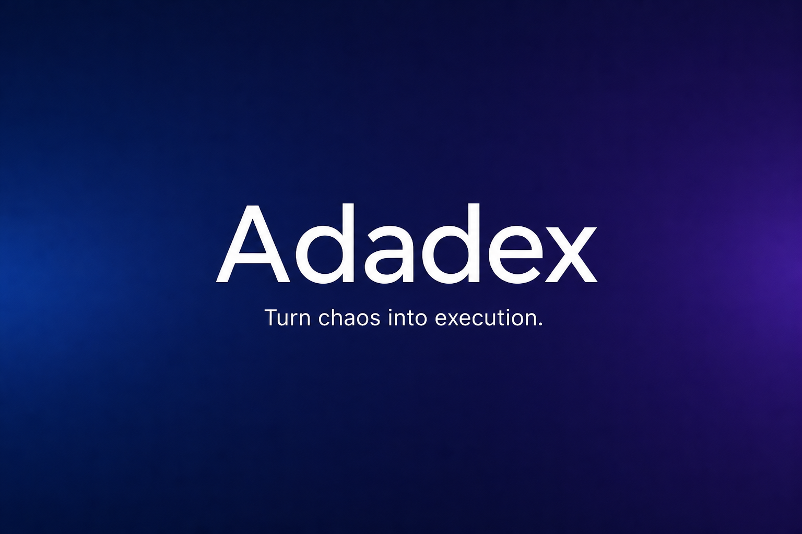

<div align="center">



</div>

# Adadex

Adadex is a web-first orchestration layer for running multiple coding agents in parallel. Each job gets its own scoped context, todo list, and notes. One agent can spawn other agents, assign them work, and exchange messages while you stay at the orchestration layer.

Terminals run [Claude Code](https://docs.claude.com/en/docs/claude-code) (`claude`) by default. Kiro CLI (`kiro-cli`) and OpenCode (`opencode`) can be selected per terminal.

> **Run it in Docker.** Adadex and the agent CLIs depend on many npm packages, any of which can be compromised. The [Docker sandbox](#run-in-docker-preferred) keeps all of it away from your files, credentials and the open internet.

## Docs

- **Start:** [Docs Home](docs/index.md), [Installation](docs/getting-started/installation.md), [Quickstart](docs/getting-started/quickstart.md)
- **Concepts:** [Mental Model](docs/concepts/mental-model.md), [Coordination](docs/concepts/coordination.md), [Runtime and API](docs/concepts/runtime-and-api.md)
- **Guides:** [Docker Sandbox](docs/guides/docker-sandbox.md), [Working With Todos](docs/guides/working-with-todos.md), [Orchestrating Child Agents](docs/guides/orchestrating-child-agents.md), [Inter-Agent Messaging](docs/guides/inter-agent-messaging.md)
- **Reference:** [CLI](docs/reference/cli.md), [API](docs/reference/api.md), [Filesystem Layout](docs/reference/filesystem-layout.md), [Troubleshooting](docs/reference/troubleshooting.md)

The Electron desktop app is in progress; see [plans/PLAN.md](docs/plans/PLAN.md).

## What Adadex Does

- Creates **coordinations** as scoped job containers, each with `CONTEXT.md`, `todo.md`, and notes
- Runs multiple coding agent terminals side by side, with the provider chosen per terminal
- Spawns child agents from todo items so parallel work has a source of truth
- Supports inter-agent messaging for completion reports, blockers, and handoffs
- Keeps agent-facing context in files so state survives beyond a chat thread
- Provides a local API and UI for terminal lifecycle, persistence, WebSocket transport, and orchestration
- Offers optional git worktrees so terminals can work in isolation

## Requirements

- Node.js `22+`
- Claude Code (`claude`) — see the [install guide](https://docs.claude.com/en/docs/claude-code)
- Optional: Kiro CLI (`kiro-cli`, `curl -fsSL https://cli.kiro.dev/install | bash`) or OpenCode (`opencode`) if you want those providers
- `git` for worktree terminals
- `gh` for GitHub pull request features
- `curl` for agent hook callbacks

## Run in Docker (preferred)

**Docker is the preferred way to run Adadex.** Running it directly on your machine gives every npm package and agent CLI it pulls in full access to your files and credentials. Use the options under [Install](#install-without-docker-not-sandboxed) only for development on Adadex itself.

The image bundles Adadex plus Claude Code, Codex, OpenCode and Kiro CLI. You only need Docker with Compose.

```bash
# 1. Point at a dedicated clone of the project the agents should work on (absolute path).
export ADADEX_WORKSPACE=/absolute/path/to/your-project-clone

# 2. Build and start.
docker compose up --build

# 3. Open http://127.0.0.1:8787
```

The workspace must be a git clone (its `.git/hooks` folder is mounted read-only), and it is mounted read-write, so use a dedicated clone.

Sign in to each agent once from an Adadex terminal (`claude`, `opencode auth login`, `kiro-cli login`). Logins are kept in the `adadex-home` Docker volume, never on your host. The volume is shared by every project you run, so you sign in once until you run `docker compose down -v`.

**Skip the Claude Code login with a token.** Run `claude setup-token` on your host, then pass the token for that run only:

```bash
read -s CLAUDE_CODE_OAUTH_TOKEN && export CLAUDE_CODE_OAUTH_TOKEN   # paste the token; it is not echoed or saved in history
ADADEX_WORKSPACE="$PWD" docker compose -f ~/Desktop/adadex/docker-compose.yml up --build
```

The token is passed into the container only when it is set in your shell, and it overrides a login stored in the volume. Any process in the container can read it, and it shows up in `docker inspect`. Do not put it in `.env` or commit it, and revoke it from your Claude account if it leaks. Do not mount `~/.claude` or `~/.claude.json` into the container: they hold your global settings, hooks and MCP configs.

```bash
docker compose up -d                  # start in the background
docker compose logs -f egress         # see which domains were allowed or denied
docker compose down                   # stop; keeps logins and state
docker compose down -v                # stop and delete logins and state
ADADEX_PORT=9000 docker compose up    # use another host port (still loopback only)
docker compose -f docker-compose.yml -f docker-compose.offline.yml up   # no network at all
```

If you run Compose from the project directory instead of the Adadex clone, point `-f` at the clone's compose file and pass the workspace explicitly (replace the path with your own Adadex clone):

```bash
ADADEX_WORKSPACE="$PWD" docker compose -f ~/Desktop/adadex/docker-compose.yml up --build
ADADEX_WORKSPACE="$PWD" docker compose -f ~/Desktop/adadex/docker-compose.yml down
```

What the sandbox enforces: a read-only root filesystem, a non-root user with every capability dropped, no host home or Docker socket, and no direct internet. All traffic leaves through a proxy that allows only the domains in [`docker/edge/allowlist.txt`](docker/edge/allowlist.txt). The UI is published on `127.0.0.1` only. Agent auto-update is switched off, so versions change only when you rebuild.

Start it with `docker compose`, not `docker run`. The image checks at start-up that capabilities are dropped, `no-new-privileges` is set, the root filesystem is read-only and there is no default route to the internet, and it exits with a message if not. To develop Adadex itself without the sandbox, set `ADADEX_ALLOW_UNSANDBOXED=1`.

What it does not protect: your workspace folder is read-write, and allowed domains can carry data out. Use a dedicated clone and review diffs before running anything on your host. Codex is installed in the image, but Adadex cannot launch it from its UI yet. Full details: [Docker Sandbox guide](docs/guides/docker-sandbox.md).

### Offline mode

For local-only work with no network at all:

```bash
docker compose -f docker-compose.yml -f docker-compose.offline.yml up
```

This removes the egress proxy, so the container has no route out. Agents that need a hosted model API (Claude, Codex, Kiro, hosted OpenCode models) will not work in this mode.

### How the image is built

- Base images are pinned by digest, and the agent CLIs install from lockfiles (`docker/agents/`). Kiro is pinned by version and sha256.
- Dependencies install with `--ignore-scripts`, so no package runs code during install.
- Compiling node-pty and the whole Adadex build run with `--network=none`, so a compromised build tool cannot send anything out while the image builds.
- The final image has no compiler and runs as a non-root user.

The dependency download step still needs the network. To bump an agent or base image, see [Maintenance](docs/guides/docker-sandbox.md#maintenance).

## Install (without Docker, not sandboxed)

Adadex is not yet published to the npm registry. These options run everything with your user's full access; prefer [Docker](#run-in-docker-preferred) for normal use.

**Local development:**

```bash
npm install
npm run dev
```

**Global CLI from a local clone:**

```bash
npm install
npm run build
npm install -g .
adadex
```

The `npm install -g adadex` registry path will work once the package is published.

## First run

On first run, Adadex creates a `.adadex/` scaffold in the project directory, assigns a stable project ID, picks an available local API port starting at `8787`, and opens the UI in your browser. Set `ADADEX_NO_OPEN=1` to suppress the browser launch.

## How It Works

Adadex separates three concerns that usually pile up in a stack of terminals:

1. **Context** lives in `.adadex/coordinations/<coordination-id>/`. `CONTEXT.md` explains the area, `todo.md` holds executable work items, and additional markdown files hold notes and handoffs.
2. **Execution** lives in terminal records and PTY sessions managed by the local API. A terminal attaches to a coordination, and several terminals can share one coordination during swarm work.
3. **Isolation** is optional. Shared terminals run in the main workspace; worktree terminals run under `.adadex/worktrees/<worktree-id>/` on `adadex/<worktree-id>` branches.

The UI reads coordination files directly, parses checkbox items from `todo.md`, and uses incomplete items to generate worker prompts. Agent hooks feed the API with agent state, transcripts, and idle events so the UI shows more than raw terminal output.

## Coordinations

A coordination is a scoped job container. It gives one slice of work its own files, notes, and `todo.md` so an agent does not need to reconstruct the entire codebase context from chat history.

Each coordination holds:

- `CONTEXT.md`: describes the area (documentation, database, API, frontend, etc.)
- `todo.md`: checkbox items that track what is done and what remains
- any additional notes or handoff files the agent needs

One coordination can represent one focused area of the codebase. You can run a single agent against it, delegate individual items to child agents, or launch a swarm to work through the list in parallel.

For the full model, see [Coordination](docs/concepts/coordination.md) and [Working With Todos](docs/guides/working-with-todos.md).

## Coordinating Multiple Agents

A terminal agent is not only a single session waiting for a human prompt. One agent can coordinate others: assign them specific jobs and exchange short messages with them while the human stays at the orchestration layer.

This differs from a vendor's built-in subagent spawning because you can directly see and control what each worker agent is doing.

For the current model, see [Orchestrating Child Agents](docs/guides/orchestrating-child-agents.md) and [Inter-Agent Messaging](docs/guides/inter-agent-messaging.md).

## State and Persistence

| Location                                   | What it holds                                       |
| ------------------------------------------ | --------------------------------------------------- |
| `.adadex/`                                 | Project-local scaffold and worktrees                |
| `~/.adadex/projects/<project-id>/state/`   | Runtime state, transcripts, metadata                |
| `.adadex/coordinations/<coordination-id>/` | Context files and todos that agents read            |

PTY sessions survive browser reloads during the idle grace period but do not survive an API restart. Adadex marks previously running terminal records as `stale` on startup when it cannot reattach them to a live PTY session. Use `adadex terminal list`, `stop`, `kill`, and `prune` to inspect and clean them up.

Adadex caps live PTY sessions at 32 by default. Set `ADADEX_MAX_TERMINAL_SESSIONS` to a positive integer to change that limit.

## Contributing

Adadex is not actively reviewing pull requests right now. If you open one and any code was written with AI, disclose the coding agent and model used. See [CONTRIBUTING.md](CONTRIBUTING.md) for full expectations.
