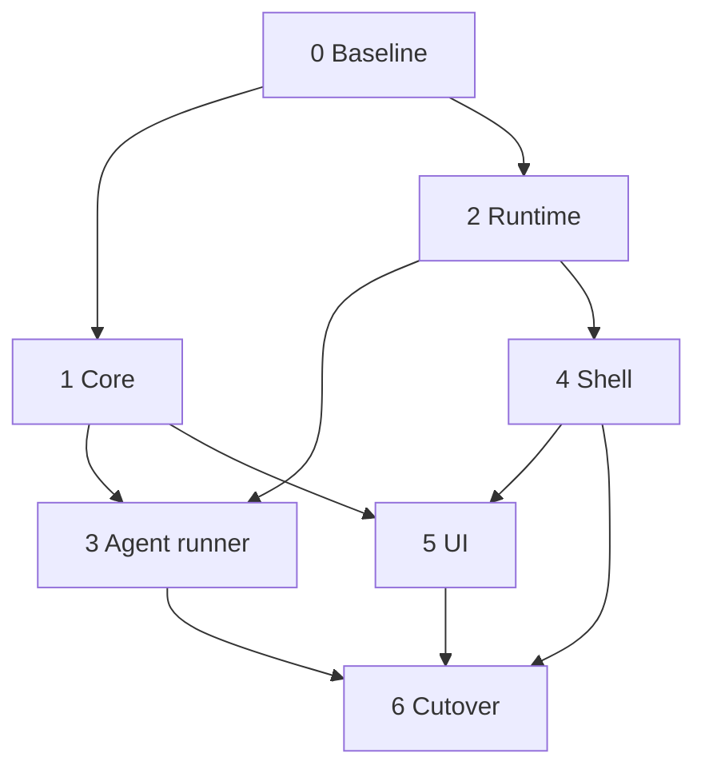

# Factory Desktop: phases and owners

Branch: `adadex-factory`. This file is the tracker. Whoever starts or finishes a phase edits the **Owner** and **Status** columns in the same change.

Phase 0 findings may change the details below. Phase 0 is not finished until its report is written to `docs/plans/phase-0-findings.md`. Do not start Phase 1 before then.

## Tracker

| Phase | What | Owner | Status | Depends on |
| --- | --- | --- | --- | --- |
| 0 | Baseline and reading | Claude (two read-only agents) | Done | none |
| 1 | Core: workflow engine, policy, action registry | Claude | Done, committed in d7eae0f | 0 |
| 2 | Runtime: process supervisor, persisted sessions, reaping | opencode | Done (no commit yet) | 0 |
| 3 | Agent runner: provider adapter, agents call actions | Claude (core half done; adapter waits on 2) | In progress | 1, 2 |
| 4 | Shell: Electron, IPC, remove server and cookie auth | Claude (host logic first; Electron not installed yet) | In progress | 2 |
| 5 | UI: factory board, processes panel, approval cards | unassigned (suggested: opencode) | Not started | 1, 4 |
| 5b | Workflow builder: n8n-style canvas to create, copy and edit workflows; skill sources settings | Storage: Claude (done). Canvas UI: unassigned (suggested: opencode) | Storage done, UI not started | 1, 5 |
| 6 | Cutover: docs, factory skill pointers, delete Python | unassigned (suggested: Claude) | Not started | 3, 4, 5 |

Phases 1 and 2 can run at the same time. Phases 3 and 4 can run at the same time once their inputs are done.

## Rules for every phase and every agent

- Work on branch `adadex-factory`. **Never commit, push, or open a PR without the user's say-so.** Leave changes in the working tree and report what changed.
- Read the scoped guides first: `AGENTS.md`, plus `packages/core/AGENTS.md`, `apps/api/AGENTS.md` or `apps/web/AGENTS.md` for the area you touch.
- Tests first. Write the test that defines the behavior, then the code. Keep the tree passing.
- `packages/core` stays free of React, HTTP, PTY and filesystem code. IO belongs in `apps/*`.
- Do not fetch from the web or add a dependency without asking.
- Do not approve the `node-pty` install script yourself. Ask the user.
- Small steps. One phase at a time per owner. If a phase needs a change in another phase's area, write it down and ask rather than editing it.
- Finish a phase by running `npm test`, `npm run build` and `npm run lint`, and paste the results in the phase's section below.

## Phase 0: Baseline and reading

Owner: Claude. Status: done, waiting for user review. Report: `docs/plans/phase-0-findings.md`.

- Read the adadex runtime, core and routes, and find everything hard-wired to Kiro.
- Diff `factory/` and `factory-review/` in the `calphonse-skills` repo.
- Name the 3 failing factory tests, the 4 skipped ones and the slowest ones.
- List the behavior a port must preserve (CLI, state files, routes, exit codes, guard rules).

Done when: `docs/plans/phase-0-findings.md` exists and the plan doc is updated.

## Design decision (2026-11-19): users build their own workflows

adadex does not preload skills or a fixed pipeline. A workflow is **data** that a user can create, copy and edit, like an n8n flow. Two presets ship so there is a baseline: `factory` (build) and `factory-review`. They use the calphonse skills by name, and a user can fork them or write their own.

- **A workflow is a JSON-serializable definition** (`WorkflowDefinition`): stages, the moves between them, the evidence each move needs (conditions), and effects (round counting, flags, named runtime work). Core runs any valid definition with one engine.
- **User workflows are validated** by `parseWorkflow` before they can run: unknown stages, dead ends, unreachable stages, bad conditions and unknown effects are all reported together.
- **Skills are referenced by name, not bundled.** `resolveSkills` matches names against the skill folders configured on this machine. A per-machine map lets an enterprise machine point `prd-mode` at its own spec skill, so one shared workflow works on every machine. A missing skill is reported, never guessed.
- **Safety is not part of a workflow.** Human-only actions (approve spec, commit locally, unblock), the push and PR block, and the allow/ask/deny policy live in the action registry and policy, outside any workflow. A user workflow cannot weaken them.

## Phase 1: Core

Where: `packages/core`.

- **Workflow definition type:** stages, allowed transitions, hints, reviewers, rounds. One definition for build and one for review. Stage names and moves come from factory's `TRANSITIONS` table.
- **Pure functions:** `advance(job, stage)` that refuses illegal moves, round counting with `max_rounds` leading to `needs-human`, and spec-approval hashing so editing an approved spec blocks the build.
- **Policy:** allow, ask and deny matching, with deny before ask before allow, and a command no rule names needing a human. Port the rules from `factory/policy.yaml`.
- **Action registry:** a typed action has an id, input schema, what it may touch, and a policy class (free, ask, blocked). Register nothing that does IO here. It only defines the contract and the registry.
- **Hard blocks in code:** no push, no PR, and no commit without a human click token.

Done when: unit tests cover every transition, every policy rule class, and the illegal moves. The core suite runs in under 5 seconds.

## Phase 2: Runtime

Where: `apps/api` (move toward `apps/runtime` if Phase 0 says so).

- **Process supervisor:** every child is spawned in its own process group. Each is recorded with pid, start time, owning job and owning session.
- **Kill-all on quit**, and **orphan reaping on launch** from the recorded registry.
- **Persisted agent sessions** so a restart can resume them instead of marking them `stale`.
- **Persisted channel messages**, replacing the in-memory queue.
- **Injectable clock and spawn** so tests need no real processes.

Done when: tests prove that quitting leaves no process behind and that a crash is reaped on the next launch.

## Phase 3: Agent runner

Where: new adapter in the runtime, a port in `packages/core`.

- Define a provider port: start a run with context files, stream events, accept action results, stop.
- First adapter: Claude Code. Keep the existing PTY terminal path as a second adapter. Kiro is kept only if the user says so.
- Agent calls go through the action registry, so the policy decides allow, ask or deny.

Done when: an agent given a goal calls a registered action, an `ask` action waits for approval, and a denied action is refused, all in tests with a fake provider.

## Phase 4: Shell

Where: new `apps/desktop`.

- Electron main process, window, tray icon showing running processes, quit handling.
- IPC between the UI and the main process, replacing the HTTP server, ports, CORS and cookie auth.
- Do not delete the old server until Phase 5 works against IPC.

Done when: the app opens, one button runs one registered action, and quitting leaves nothing running.

## Phase 5b: Workflow builder

Where: `apps/web` (UI) and the runtime (storage).

- A canvas where each stage is a node and each move is an edge, with the conditions and effects edited in a side panel. adadex already has a canvas to start from.
- Create, duplicate a preset, edit, and delete user workflows. Presets are read-only, and editing one makes a copy.
- Store user workflows as JSON files per project and per machine. Run `parseWorkflow` on every save and show its errors next to the field.
- Skill sources settings: choose the folders to scan, see which skills each stage found, and set the per-machine map.

Done when: a user can build a three-stage workflow in the UI, with a skill from a folder that is not calphonse-skills, and run a job through it.

## Phase 5: UI

Where: `apps/web`.

- Factory board: jobs by stage, with a button for each action.
- Processes panel: list, elapsed time, Kill.
- Approval cards for `ask` actions.
- A native Commit locally button that is the human click.
- Keep the canvas and deck views unless the user decides otherwise.

Done when: component tests pass and a few end-to-end tests drive the real app.

## Phase 6: Cutover

- Update adadex docs and `AGENTS.md`.
- In the `calphonse-skills` repo, reduce the factory skills to short pointers to the app. **Only after the user agrees.** The Python stays until the scenarios from the factory tests pass in the new app.
- Remove the old HTTP server and cookie auth.

Done when: parity is shown, and the user approves deleting the Python.

## Log

Add a line per handoff: date, phase, who, what changed, what is next.

- Phase 0 started by Claude.
- 2026-11-19 Phase 2 by opencode. Verified node-pty already puts each PTY child in its own process group (`POSIX_SPAWN_SETSID` on macOS, `forkpty` on Linux); the bug was `pty.kill()` signalling only the leader. Added `atomicJsonFile.ts` (temp file plus rename) and `processSupervisor.ts` (group kill, kill-all on quit, launch reaping with pid-reuse guard) in `apps/api`, wired into `sessionRuntime.ts` and `terminalRuntime.ts`, with `docs/reference/filesystem-layout.md` updated for `state/processes.json`. 125 api tests pass, root build and lint clean. Still to do in Phase 2: persisted agent sessions and persisted channel messages.
- Phase 0 finished by Claude. Findings in `docs/plans/phase-0-findings.md`. Next: user reviews, then Phases 1 and 2 can start in parallel.
- Phase 1 done by Claude, uncommitted. In `packages/core`: `domain/workflow.ts` (build and review definitions), `application/advanceJob.ts` (pure stage moves with evidence and rounds), `application/evaluatePolicy.ts` (guard semantics), `domain/action.ts` and `application/actionRegistry.ts` (typed actions, hard blocks, human-click class). Core tests: 62 pass, `tsc` and `biome` clean.
- Phase 3, core half done by Claude, uncommitted: `ports/AgentProvider.ts`, `ports/ActionPorts.ts` and `application/runAgent.ts` (every agent call goes through the registry; tested with a fake provider). Still to do: the Claude Code adapter and the executor, which need the Phase 2 supervisor. opencode: Phase 2 files in `apps/api` were not touched by Claude.
- Design change by Claude, per the user: workflows are user-built data, with `factory` and `factory-review` as bundled presets and no preloaded skills. Core refactored to a declarative engine (`WorkflowDefinition`, `parseWorkflow`, `resolveSkills`, `presets/`). The old behavior tests pass unchanged against the presets, so nothing regressed. Added Phase 5b (workflow builder). Core tests: 81 pass.
- Claude checked the tree: Phase 1 and the core half of Phase 3 are committed in d7eae0f together with opencode's Phase 2 files, and `origin/adadex-factory` exists. Claude made no commit and no push. Tests: core 81, api 125, web 79 pass.
- Phase 4, host logic by Claude (`apps/desktop`, no Electron yet): `host/actionHost.ts` is the only place a request becomes a run and the only place a human click is made. A human-only action runs only after a native OS confirmation, which web content and agents cannot press. `jobs/` holds the job store (atomic writes, audit log), the facts reader, and executors for advance, approve spec and unblock. 17 tests, all on temp dirs and fakes. Core `runAgent` gained `onNeedsHumanClick` so the UI can show the button when an agent asks for a human-only action. Still to do: Electron main process, IPC, tray, window, and removing the old server. Blocked on approving the Electron dependency and its install script.
- Phase 5b storage by Claude (`apps/desktop`): `skills/fsSkillCatalog.ts` (scans configured folders, earlier folder wins, ships none), `workflows/workflowStore.ts` (user workflows as validated JSON files, presets read-only, fork a preset to edit it, corrupt or shadowing files ignored), `config/machineConfig.ts` (skill folders and the per-machine skill map). Desktop tests: 31 pass. The canvas UI is not started.
- 2026-11-19 Phase 2 finished by opencode. Persisted channel messages: `channelMessageStore.ts` loads/saves `state/channel-messages.json` with temp-file-and-rename and record validation; `createChannelMessaging` now uses it, keeps the delivered flag across restarts, and generates message ids that stay unique across restarts. Persisted agent sessions: `sessionRecovery.ts` marks interrupted `running` terminals `stopped` with reason `restart_pending` and clears dead process fields while keeping the prompt, provider and input draft so the next attach relaunches the same session; a process still alive after launch-time reaping stays `stale`. Updated the startup-lifecycle test and `docs/reference/filesystem-layout.md`. API tests 137 pass, API build clean, targeted Biome check clean. No commit or push.
