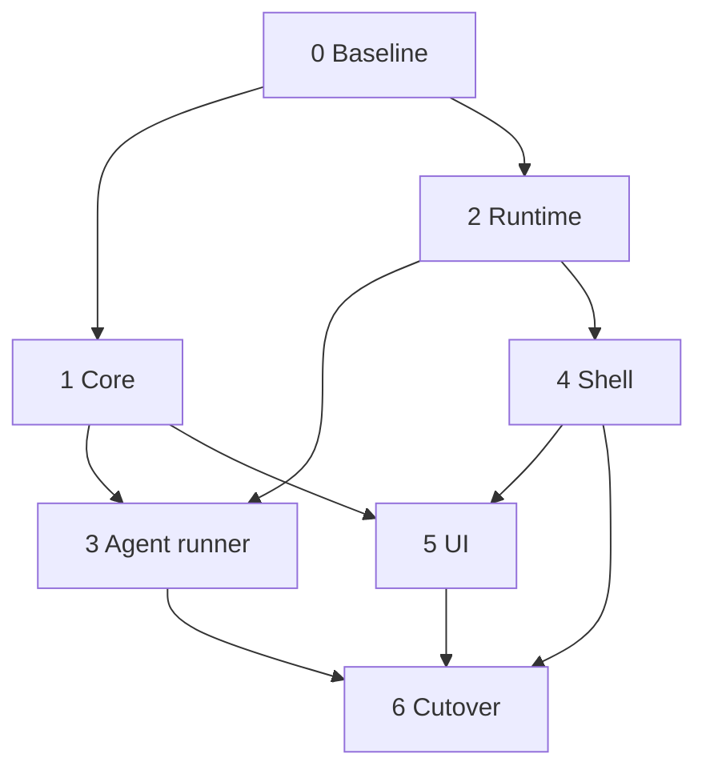

# Factory Desktop: phases and owners

Branch: `adadex-factory`. This file is the tracker. Whoever starts or finishes a phase edits the **Owner** and **Status** columns in the same change.

Phase 0 findings may change the details below. Phase 0 is not finished until its report is written to `docs/plans/phase-0-findings.md`. Do not start Phase 1 before then.

## Tracker

| Phase | What | Owner | Status | Depends on |
| --- | --- | --- | --- | --- |
| 0 | Baseline and reading | Claude (two read-only agents) | Done | none |
| 1 | Core: workflow engine, policy, action registry | Claude | Done, committed in d7eae0f | 0 |
| 2 | Runtime: process supervisor, persisted sessions, reaping | opencode | Done, committed in 8b4450b and 408a367 | 0 |
| 3 | Agent runner: provider adapter, agents call actions | Claude | Claude Code adapter, run-gate and commit executors, tool guard and git guard done. No OpenCode adapter |  1, 2 |
| 4 | Shell: Electron, IPC, remove server and cookie auth | Claude | Done (shell runs and is smoke-tested). The old HTTP server and cookie auth are removed in Phase 6 | 2 |
| 5 | UI: factory board, processes panel, approval cards | opencode | Board, approval cards, processes panel and desktop shell integration done; process data still needs a supervisor port | 1, 4 |
| 5b | Workflow builder: n8n-style canvas to create, copy and edit workflows; skill sources settings | Storage and canvas logic: Claude (done). Canvas UI: unassigned (suggested: opencode) | Logic done, UI not started | 1, 5 |
| 6 | Cutover: docs, factory skill pointers, delete Python | Claude (plan written, nothing deleted) | Plan in `phase-6-cutover.md`; needs four decisions from the user | 3, 4, 5 |

Phases 1 and 2 can run at the same time. Phases 3 and 4 can run at the same time once their inputs are done.

## Rules for every phase and every agent

- Work on branch `adadex-factory`. **Never commit, push, or open a PR without the user's say-so.** Leave changes in the working tree and report what changed.
- Read the scoped guides first: `AGENTS.md`, plus `packages/core/AGENTS.md`, `apps/api/AGENTS.md` or `apps/web/AGENTS.md` for the area you touch.
- Tests first. Write the test that defines the behavior, then the code. Keep the tree passing.
- `packages/core` stays free of React, HTTP, PTY and filesystem code. IO belongs in `apps/*`.
- Do not fetch from the web or add a dependency without asking.
- Do not approve the `node-pty` install script yourself. Ask the user.
- Small steps. One phase at a time per owner. If a phase needs a change in another phase's area, write it down and ask rather than editing it.
- Finish a phase by running `npm test`, `npm run build` and `npm run lint`, and paste the results in the phase's section below.

## Phase 0: Baseline and reading

Owner: Claude. Status: done, waiting for user review. Report: `docs/plans/phase-0-findings.md`.

- Read the adadex runtime, core and routes, and find everything hard-wired to Kiro.
- Diff `factory/` and `factory-review/` in the `calphonse-skills` repo.
- Name the 3 failing factory tests, the 4 skipped ones and the slowest ones.
- List the behavior a port must preserve (CLI, state files, routes, exit codes, guard rules).

Done when: `docs/plans/phase-0-findings.md` exists and the plan doc is updated.

## Design decision (2026-11-19): users build their own workflows

adadex does not preload skills or a fixed pipeline. A workflow is **data** that a user can create, copy and edit, like an n8n flow. Two presets ship so there is a baseline: `factory` (build) and `factory-review`. They use the calphonse skills by name, and a user can fork them or write their own.

- **A workflow is a JSON-serializable definition** (`WorkflowDefinition`): stages, the moves between them, the evidence each move needs (conditions), and effects (round counting, flags, named runtime work). Core runs any valid definition with one engine.
- **User workflows are validated** by `parseWorkflow` before they can run: unknown stages, dead ends, unreachable stages, bad conditions and unknown effects are all reported together.
- **Skills are referenced by name, not bundled.** `resolveSkills` matches names against the skill folders configured on this machine. A per-machine map lets an enterprise machine point `prd-mode` at its own spec skill, so one shared workflow works on every machine. A missing skill is reported, never guessed.
- **Safety is not part of a workflow.** Human-only actions (approve spec, commit locally, unblock), the push and PR block, and the allow/ask/deny policy live in the action registry and policy, outside any workflow. A user workflow cannot weaken them.

## Phase 1: Core

Where: `packages/core`.

- **Workflow definition type:** stages, allowed transitions, hints, reviewers, rounds. One definition for build and one for review. Stage names and moves come from factory's `TRANSITIONS` table.
- **Pure functions:** `advance(job, stage)` that refuses illegal moves, round counting with `max_rounds` leading to `needs-human`, and spec-approval hashing so editing an approved spec blocks the build.
- **Policy:** allow, ask and deny matching, with deny before ask before allow, and a command no rule names needing a human. Port the rules from `factory/policy.yaml`.
- **Action registry:** a typed action has an id, input schema, what it may touch, and a policy class (free, ask, blocked). Register nothing that does IO here. It only defines the contract and the registry.
- **Hard blocks in code:** no push, no PR, and no commit without a human click token.

Done when: unit tests cover every transition, every policy rule class, and the illegal moves. The core suite runs in under 5 seconds.

## Phase 2: Runtime

Where: `apps/api` (move toward `apps/runtime` if Phase 0 says so).

- **Process supervisor:** every child is spawned in its own process group. Each is recorded with pid, start time, owning job and owning session.
- **Kill-all on quit**, and **orphan reaping on launch** from the recorded registry.
- **Persisted agent sessions** so a restart can resume them instead of marking them `stale`.
- **Persisted channel messages**, replacing the in-memory queue.
- **Injectable clock and spawn** so tests need no real processes.

Done when: tests prove that quitting leaves no process behind and that a crash is reaped on the next launch.

## Phase 3: Agent runner

Where: new adapter in the runtime, a port in `packages/core`.

- Define a provider port: start a run with context files, stream events, accept action results, stop.
- First adapter: Claude Code. Keep the existing PTY terminal path as a second adapter. Kiro is kept only if the user says so.
- Agent calls go through the action registry, so the policy decides allow, ask or deny.

Done when: an agent given a goal calls a registered action, an `ask` action waits for approval, and a denied action is refused, all in tests with a fake provider.

## Phase 4: Shell

Where: new `apps/desktop`.

- Electron main process, window, tray icon showing running processes, quit handling.
- IPC between the UI and the main process, replacing the HTTP server, ports, CORS and cookie auth.
- Do not delete the old server until Phase 5 works against IPC.

Done when: the app opens, one button runs one registered action, and quitting leaves nothing running.

## Phase 5b: Workflow builder

Where: `apps/web` (UI) and the runtime (storage).

- A canvas where each stage is a node and each move is an edge, with the conditions and effects edited in a side panel. adadex already has a canvas to start from.
- Create, duplicate a preset, edit, and delete user workflows. Presets are read-only, and editing one makes a copy.
- Store user workflows as JSON files per project and per machine. Run `parseWorkflow` on every save and show its errors next to the field.
- Skill sources settings: choose the folders to scan, see which skills each stage found, and set the per-machine map.

Done when: a user can build a three-stage workflow in the UI, with a skill from a folder that is not calphonse-skills, and run a job through it.

## Phase 5: UI

Where: `apps/web`.

- Factory board: jobs by stage, with a button for each action.
- Processes panel: list, elapsed time, Kill.
- Approval cards for `ask` actions.
- A native Commit locally button that is the human click.
- Keep the canvas and deck views unless the user decides otherwise.

Done when: component tests pass and a few end-to-end tests drive the real app.

## Phase 6: Cutover

- Update adadex docs and `AGENTS.md`.
- In the `calphonse-skills` repo, reduce the factory skills to short pointers to the app. **Only after the user agrees.** The Python stays until the scenarios from the factory tests pass in the new app.
- Remove the old HTTP server and cookie auth.

Done when: parity is shown, and the user approves deleting the Python.

## Log

Add a line per handoff: date, phase, who, what changed, what is next.

- Phase 0 started by Claude.
- 2026-11-19 Phase 2 by opencode. Verified node-pty already puts each PTY child in its own process group (`POSIX_SPAWN_SETSID` on macOS, `forkpty` on Linux); the bug was `pty.kill()` signalling only the leader. Added `atomicJsonFile.ts` (temp file plus rename) and `processSupervisor.ts` (group kill, kill-all on quit, launch reaping with pid-reuse guard) in `apps/api`, wired into `sessionRuntime.ts` and `terminalRuntime.ts`, with `docs/reference/filesystem-layout.md` updated for `state/processes.json`. 125 api tests pass, root build and lint clean. Still to do in Phase 2: persisted agent sessions and persisted channel messages.
- Phase 0 finished by Claude. Findings in `docs/plans/phase-0-findings.md`. Next: user reviews, then Phases 1 and 2 can start in parallel.
- Phase 1 done by Claude, uncommitted. In `packages/core`: `domain/workflow.ts` (build and review definitions), `application/advanceJob.ts` (pure stage moves with evidence and rounds), `application/evaluatePolicy.ts` (guard semantics), `domain/action.ts` and `application/actionRegistry.ts` (typed actions, hard blocks, human-click class). Core tests: 62 pass, `tsc` and `biome` clean.
- Phase 3, core half done by Claude, uncommitted: `ports/AgentProvider.ts`, `ports/ActionPorts.ts` and `application/runAgent.ts` (every agent call goes through the registry; tested with a fake provider). Still to do: the Claude Code adapter and the executor, which need the Phase 2 supervisor. opencode: Phase 2 files in `apps/api` were not touched by Claude.
- Design change by Claude, per the user: workflows are user-built data, with `factory` and `factory-review` as bundled presets and no preloaded skills. Core refactored to a declarative engine (`WorkflowDefinition`, `parseWorkflow`, `resolveSkills`, `presets/`). The old behavior tests pass unchanged against the presets, so nothing regressed. Added Phase 5b (workflow builder). Core tests: 81 pass.
- Claude checked the tree: Phase 1 and the core half of Phase 3 are committed in d7eae0f together with opencode's Phase 2 files, and `origin/adadex-factory` exists. Claude made no commit and no push. Tests: core 81, api 125, web 79 pass.
- Phase 4, host logic by Claude (`apps/desktop`, no Electron yet): `host/actionHost.ts` is the only place a request becomes a run and the only place a human click is made. A human-only action runs only after a native OS confirmation, which web content and agents cannot press. `jobs/` holds the job store (atomic writes, audit log), the facts reader, and executors for advance, approve spec and unblock. 17 tests, all on temp dirs and fakes. Core `runAgent` gained `onNeedsHumanClick` so the UI can show the button when an agent asks for a human-only action. Still to do: Electron main process, IPC, tray, window, and removing the old server. Blocked on approving the Electron dependency and its install script.
- Phase 5b storage by Claude (`apps/desktop`): `skills/fsSkillCatalog.ts` (scans configured folders, earlier folder wins, ships none), `workflows/workflowStore.ts` (user workflows as validated JSON files, presets read-only, fork a preset to edit it, corrupt or shadowing files ignored), `config/machineConfig.ts` (skill folders and the per-machine skill map). Desktop tests: 31 pass. The canvas UI is not started.
- 2026-11-19 Phase 2 finished by opencode. Persisted channel messages: `channelMessageStore.ts` loads/saves `state/channel-messages.json` with temp-file-and-rename and record validation; `createChannelMessaging` now uses it, keeps the delivered flag across restarts, and generates message ids that stay unique across restarts. Persisted agent sessions: `sessionRecovery.ts` marks interrupted `running` terminals `stopped` with reason `restart_pending` and clears dead process fields while keeping the prompt, provider and input draft so the next attach relaunches the same session; a process still alive after launch-time reaping stays `stale`. Updated the startup-lifecycle test and `docs/reference/filesystem-layout.md`. API tests 137 pass, API build clean, targeted Biome check clean. No commit or push.
- Phase 3 adapter by Claude (`apps/desktop/src/agents`): Claude Code runs headless (`claude -p`, stream-json) with only one tool, `adadex_action`, served by a small MCP bridge (`mcp-bridge.mjs`, Node built-ins only) that sends every call over a local socket to the action host. Its own tools stay off unless the caller allows them (pass the guard `--settings` through `extraArgs`). The agent runs in its own process group, so stop kills what it started. 41 desktop tests pass, including the whole chain through a real bridge process. Live check against the real `claude` 2.1.311: the agent called `job.advance` (ran) and `job.commit_local` (answered needs-human-click, never ran, no dialog), and the app was told to show the button. Not done: executors for `job.run_gate` and `job.commit_local`, wiring the guard policy into `--settings`, and the OpenCode adapter.
- Phase 3, run-gate executor by Claude (`apps/desktop/src/jobs`): `job.run_gate` runs the project's checks in the job's folder, fails without running anything when a protected file was touched (list now in core as `PROTECTED_FLOOR` and `findProtectedHits`), applies a timeout that kills the whole process group, and writes `round-N/checks.md` (`GATE`, `TREE`, `REASON`) where the engine already reads it. A stage may run the gate when one of its moves looks at the gate result. Differences from factory: it does not yet check for commits the board did not make, and it does not allow the gate in the `ship` stage. Desktop tests: 53 pass.
- 2026-11-19 Open items resolved by opencode. The three failing factory tests in `calphonse-skills` are fixed: `test_watch` fixtures now set fixed mtimes for every dashboard `.ts`/`.js` pair, not just the three original sources. The `git fetch` drift is resolved by making `factory/policy.yaml` and `factory-review/policy.yaml` identical again: the two `ask` entries were removed and explicit `allow` entries (`git fetch*`, `git -C * fetch*`) were added to both, matching commit 7d900d1's intent to let review agents fetch while keeping the identical-baseline test. Verified the baseline test and both watch tests pass.
- 2026-11-19 User approved the `node-pty` install script. `node_modules/node-pty` already has the darwin prebuilds (`pty.node`, `spawn-helper`) and `ignore-scripts` is false, so no rebuild was needed. No commit or push.
- Phase 3 commit executor and Phase 4 request layer by Claude (`apps/desktop`): `job.commit_local` commits only what the gate checked (passing gate, tree fingerprint unchanged since the gate, no commits the app did not make, no protected paths, commit message present) and the git port has no push or remote operation. `ipc/` holds `parseRequest` (the UI is untrusted), `approvalBroker` (agent ask-actions wait for the UI) and `hostApi` (the one entry point Electron main will forward to). Desktop tests: 74 pass. Known safety gaps, not yet closed: the native confirmation is an injected function with no Electron dialog behind it yet; the guard policy is not wired into Claude Code `--settings`; no git hooks stop an agent with its own shell from running `git commit` or `git push` in the worktree; where the `checks` command is stored must be a place an agent cannot write.
- Safety gaps closed by Claude (`packages/core`, `apps/desktop`): (1) the tool policy: core `evaluateToolCall` plus `BUILD_POLICY` and `REVIEW_POLICY` generated from factory's policy files; a PreToolUse hook (`agents/guard-hook.mjs`) asks the running app before every tool call and blocks on any doubt (app unreachable, bad input, timeout), `ask` results become approval cards, and the provider refuses to give an agent its own tools without a guard. Checked live against real Claude Code with Bash and Write turned on: `.env` write refused, `git push` refused, `git commit` sent to approval and declined, only the harmless write happened. (2) git hooks (`jobs/gitGuard.ts`): in a job's worktree, commit, push and updates to the job's branch fail unless the human key is present; the key exists only in app memory and is passed to the one commit call, the repo's own hooks still run, the hash file is 0600 and outside the worktree. (3) `withProtectedLocations` lets the app mark the machine config and state folder as never writable by an agent, so it cannot change the `checks` command. Desktop tests: 94 pass. Still open: the native confirmation has no Electron dialog yet, and the new locations are not yet applied where the app is assembled (there is no assembly yet).
- Composition root by Claude (`apps/desktop/src/app/createApp.ts`): wires the stores, the human key (memory only), the tool policy with the machine config and state folders protected, the action host, the git guard and the request layer. The `make-worktree` effect is real now: leaving a stage that asks for it creates `.adadex/worktrees/<job>` on branch `adadex/<job>` and installs the commit and push lock before any agent can touch it. The gate's `checks` command is read from the machine data folder, never from the repo an agent edits. End-to-end test with real git and a user-made workflow: new job, worktree, an agent-style `git commit` and `update-ref` refused, gate PASS, native confirmation, a commit of exactly the gated files on the job's branch, `main` untouched, no remote, audit log written. Desktop tests: 98 pass. What is left for Phase 4 is only the Electron shell itself: window, tray, preload, the native `dialog` behind `confirm`, and forwarding requests to `app.api.handle`.
- Phase 4 shell by Claude (`apps/desktop/src/shell`, `scripts/`): Electron 45.2.3 (pinned, over two weeks old; its binary download was run by hand because npm skips it) and esbuild 0.28.2 (pinned, already in the tree). The main process builds the app, shows the native OS dialog for human-only actions (Cancel is the default button), forwards page requests to `app.api.handle` only when the sender is the app's own page, denies all permission requests, blocks navigation and new windows, and on quit stops every running agent and declines waiting approvals. Tray shows how many approvals are waiting. `npm run smoke --workspace=@adadex/desktop` starts the real app hidden and checks it: own page lists both presets, garbage request rejected, human-only action reaches the native dialog (declined in smoke), `git.push` unknown, and a stranger page using the same bridge is refused. Note for anyone launching it from VS Code: that host sets `ELECTRON_RUN_AS_NODE`, which makes Electron start as plain Node, so clear it first.
- Verification by Claude on 2026-11-19: core 93, desktop 98, api 137 tests pass; typecheck clean for core, desktop and api; `npm run build` passes; the Electron smoke passes; the live Claude Code guard check passes again (`.env` write refused, `git push` refused, `git commit` sent to approval). Found and not caused by this work: (a) `npm run lint` fails on a11y errors in `apps/web` files that are identical to `main` (`GitHubPrimaryView.tsx`, `Terminal.tsx`, `CodeIntelArcDiagram.tsx`, `CodeIntelTreemap.tsx`, `CanvasOrchestrationPanel.tsx`, `ActiveAgentsSidebar.tsx`), plus two `biome.json` deprecation notices; (b) `npm audit --audit-level=high` reports vite 8.3.2 and zod 4.6.5 (through knip), the same versions as `main`, and a vite 8.3.5 Dependabot branch exists; (c) `apps/web/tests/hotkeys.test.tsx` "parses primary nav keys 1-7" fails because the factory board added nav item 8 and the test still expects 8 to be null. That last one is the owner of Phase 5 to fix.
- Phase 5b canvas logic by Claude (`packages/core`): `toGraph` turns a workflow into laid-out nodes and edges (stages placed left to right by distance from the start, loops marked, moves to needs-human drawn as a badge, conditions and effects in plain words); `editWorkflow` has pure edit operations (add, remove and rename stages, wire and unwire moves, set conditions, effects, skills, hints, start stage, terminal) that never change their input; `problemsOf` lists what stops a half-drawn workflow from running. A canvas can use these directly and then call `workflows.save`. Core tests: 114 pass. The canvas UI itself is not started.
- Phase 6 plan by Claude: `docs/plans/phase-6-cutover.md`. Maps every Python test area to coverage in the new app. Not yet covered: integrity checks, the unattended loop (queue, concurrency, stall limit), stack detection, the rule that a reviewer who edits a tracked file parks the job, the review base and head mode, keep-awake, and the attack probes. Unblock behaves differently from factory. Nothing was deleted in either repo.
- 2026-11-19 Phase 5 UI by opencode. Added a Factory primary view (nav item 8, key 8) with jobs grouped by workflow stage, per-job action buttons, approval cards with Approve/Decline, and a processes panel with elapsed time and Kill. Every button goes through the host; `apps/web/src/runtime/factoryHost.ts` accepts either the Electron preload's `window.adadex` (`request`/`onEvent`) or an injected test bridge, parses host responses, and refreshes on events. Added `approvals.list`, `processes.list` and `process.kill` request kinds to the desktop contract and host API; the process port is optional until Electron supplies a supervisor, so the panel renders empty today. The Electron shell now loads the built web app instead of the static probe page; `build-shell.mjs` builds web first and copies it next to main, with relative asset paths and a page CSP. Verification: web 93 tests, desktop 100 tests, web and desktop typechecks, Biome on changed files, and `npm run smoke --workspace=@adadex/desktop` (real window: presets listed, garbage refused, human-only action reached the native dialog, push unknown, stranger page refused). No commit or push.
- Roles and autonomy by Claude, per the user (enterprise standards; an agent cannot change or switch its own role): `docs/plans/security-model.md` has the model, the controls and the gaps. Core: `RoleDefinition`, `parseRole` (refuses human-only actions, network tools and the app's own files), `authorizeForRole`, `policyForRole` (writes limited to the role's own documents), `planTick`, eleven preset roles bound to the stages of both workflows (`stage.role`). Desktop: role store (data folder, invalid files ignored), `createRoleRunner` (role read from the stage, bound and frozen per run, budgets, audit with role and run id, integrity check before every run), `createScheduler` (off by default, concurrency and stall limits), hash-chained audit log, gate results that count only when the audit log vouches for them. Removed `runAgentOnJob`: no agent can run without a role. Found and fixed while testing: rule folders were not resolved to real paths, so a role's folder scope silently never matched on macOS. Verified live with real Claude Code in a role tempted to overstep: own notes and code allowed; another role's document, a forged `checks.md`, `git push`, a stage outside the role, `role.set` and `job.commit_local` all refused, and no forged file exists afterwards. Tests: core 145, desktop 127, api 137, web 93 pass. Not done: a request and UI toggle for the scheduler (needs a native confirmation), role and workflow editors, audit signing, user identity (see the gaps in the security model).
- Local SQLite log database by Claude, per the user (`apps/desktop/src/logs`, `docs/plans/security-model.md`): the audit chain moved out of per-job `audit.log` files into `<data folder>/logs/adadex.db` (Node built-in `node:sqlite`, no new dependency; desktop now requires Node 22.13+). Append-only triggers, a rule that stops a chain forking, mode 0600 file in a 0700 folder, write-ahead logging with full sync. A second table holds operational events (guard decisions, approvals, processes, runs, loop, integrity failures, app start and stop), redacted before writing and pruned after 90 days. New requests `logs.query` and `audit.verify`. Also added: process registry behind `processes.list` and `process.kill` (agents and checks are listed and can be stopped; quitting stops them), requests `roles.list`, `roles.save`, `roles.remove`, `scheduler.status`, and `scheduler.set` (turning the loop on needs the native dialog, turning it off does not). Fixed: the gate no longer fails on the app's own state folder when a job runs at the project root, and a commit now requires the job's own worktree. Bugs found by the new tests: the redaction replacer corrupted matches with no capture group. Tests: core 145, desktop 148, api 137, web 93 pass; the live Claude Code role check passes against the database.
