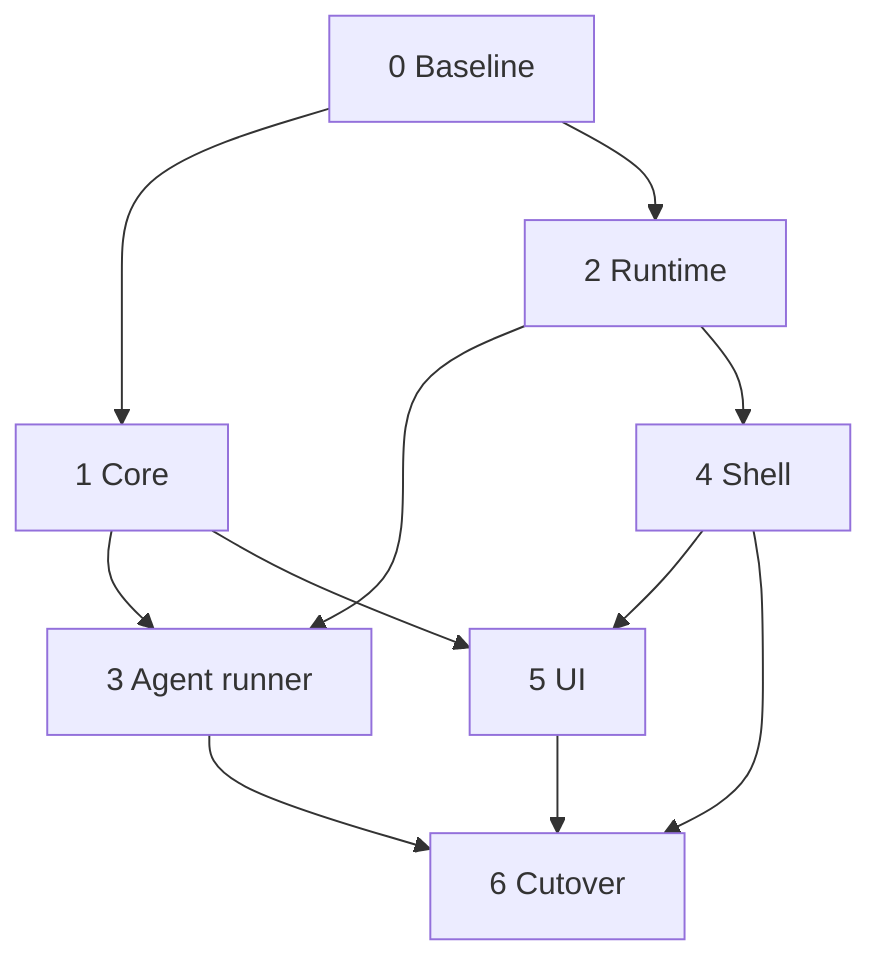

# Factory Desktop: phases and owners

Branch: `adadex-factory`. This file is the tracker. Whoever starts or finishes a phase edits the **Owner** and **Status** columns in the same change.

Phase 0 findings may change the details below. Phase 0 is not finished until its report is written to `docs/plans/phase-0-findings.md`. Do not start Phase 1 before then.

## Tracker

| Phase | What | Owner | Status | Depends on |
| --- | --- | --- | --- | --- |
| 0 | Baseline and reading | Claude (two read-only agents) | Done, waiting for user review | none |
| 1 | Core: workflow engine, policy, action registry | unassigned (suggested: Claude) | Not started | 0 |
| 2 | Runtime: process supervisor, persisted sessions, reaping | unassigned (suggested: opencode) | Not started | 0 |
| 3 | Agent runner: provider adapter, agents call actions | unassigned (suggested: Claude) | Not started | 1, 2 |
| 4 | Shell: Electron, IPC, remove server and cookie auth | unassigned (suggested: opencode) | Not started | 2 |
| 5 | UI: factory board, processes panel, approval cards | unassigned (suggested: opencode) | Not started | 1, 4 |
| 6 | Cutover: docs, factory skill pointers, delete Python | unassigned (suggested: Claude) | Not started | 3, 4, 5 |

Phases 1 and 2 can run at the same time. Phases 3 and 4 can run at the same time once their inputs are done.

## Rules for every phase and every agent

- Work on branch `adadex-factory`. **Never commit, push, or open a PR without the user's say-so.** Leave changes in the working tree and report what changed.
- Read the scoped guides first: `AGENTS.md`, plus `packages/core/AGENTS.md`, `apps/api/AGENTS.md` or `apps/web/AGENTS.md` for the area you touch.
- Tests first. Write the test that defines the behavior, then the code. Keep the tree passing.
- `packages/core` stays free of React, HTTP, PTY and filesystem code. IO belongs in `apps/*`.
- Do not fetch from the web or add a dependency without asking.
- Do not approve the `node-pty` install script yourself. Ask the user.
- Small steps. One phase at a time per owner. If a phase needs a change in another phase's area, write it down and ask rather than editing it.
- Finish a phase by running `npm test`, `npm run build` and `npm run lint`, and paste the results in the phase's section below.

## Phase 0: Baseline and reading

Owner: Claude. Status: done, waiting for user review. Report: `docs/plans/phase-0-findings.md`.

- Read the adadex runtime, core and routes, and find everything hard-wired to Kiro.
- Diff `factory/` and `factory-review/` in the `calphonse-skills` repo.
- Name the 3 failing factory tests, the 4 skipped ones and the slowest ones.
- List the behavior a port must preserve (CLI, state files, routes, exit codes, guard rules).

Done when: `docs/plans/phase-0-findings.md` exists and the plan doc is updated.

## Phase 1: Core

Where: `packages/core`.

- **Workflow definition type:** stages, allowed transitions, hints, reviewers, rounds. One definition for build and one for review. Stage names and moves come from factory's `TRANSITIONS` table.
- **Pure functions:** `advance(job, stage)` that refuses illegal moves, round counting with `max_rounds` leading to `needs-human`, and spec-approval hashing so editing an approved spec blocks the build.
- **Policy:** allow, ask and deny matching, with deny before ask before allow, and a command no rule names needing a human. Port the rules from `factory/policy.yaml`.
- **Action registry:** a typed action has an id, input schema, what it may touch, and a policy class (free, ask, blocked). Register nothing that does IO here. It only defines the contract and the registry.
- **Hard blocks in code:** no push, no PR, and no commit without a human click token.

Done when: unit tests cover every transition, every policy rule class, and the illegal moves. The core suite runs in under 5 seconds.

## Phase 2: Runtime

Where: `apps/api` (move toward `apps/runtime` if Phase 0 says so).

- **Process supervisor:** every child is spawned in its own process group. Each is recorded with pid, start time, owning job and owning session.
- **Kill-all on quit**, and **orphan reaping on launch** from the recorded registry.
- **Persisted agent sessions** so a restart can resume them instead of marking them `stale`.
- **Persisted channel messages**, replacing the in-memory queue.
- **Injectable clock and spawn** so tests need no real processes.

Done when: tests prove that quitting leaves no process behind and that a crash is reaped on the next launch.

## Phase 3: Agent runner

Where: new adapter in the runtime, a port in `packages/core`.

- Define a provider port: start a run with context files, stream events, accept action results, stop.
- First adapter: Claude Code. Keep the existing PTY terminal path as a second adapter. Kiro is kept only if the user says so.
- Agent calls go through the action registry, so the policy decides allow, ask or deny.

Done when: an agent given a goal calls a registered action, an `ask` action waits for approval, and a denied action is refused, all in tests with a fake provider.

## Phase 4: Shell

Where: new `apps/desktop`.

- Electron main process, window, tray icon showing running processes, quit handling.
- IPC between the UI and the main process, replacing the HTTP server, ports, CORS and cookie auth.
- Do not delete the old server until Phase 5 works against IPC.

Done when: the app opens, one button runs one registered action, and quitting leaves nothing running.

## Phase 5: UI

Where: `apps/web`.

- Factory board: jobs by stage, with a button for each action.
- Processes panel: list, elapsed time, Kill.
- Approval cards for `ask` actions.
- A native Commit locally button that is the human click.
- Keep the canvas and deck views unless the user decides otherwise.

Done when: component tests pass and a few end-to-end tests drive the real app.

## Phase 6: Cutover

- Update adadex docs and `AGENTS.md`.
- In the `calphonse-skills` repo, reduce the factory skills to short pointers to the app. **Only after the user agrees.** The Python stays until the scenarios from the factory tests pass in the new app.
- Remove the old HTTP server and cookie auth.

Done when: parity is shown, and the user approves deleting the Python.

## Log

Add a line per handoff: date, phase, who, what changed, what is next.

- Phase 0 started by Claude.
- Phase 0 finished by Claude. Findings in `docs/plans/phase-0-findings.md`. Next: user reviews, then Phases 1 and 2 can start in parallel.
